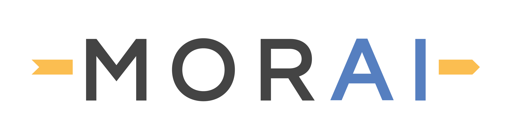

[](https://www.morai.ai)
===
# MORAI - Drive example (UDP)

First step to enjoy the `MORAI Sim: Drive` with UDP.

```
./
├── autonomous_driving     # [Autonomous Driving] autonomous driving module
├── network                # UDP network connection
│    ├── receiver            # UDP network - receiver functions
│    ├── sender              # UDP network - sender functions
│    ├── config.json         # UDP network connection config file
│    └── udp_manager.py      # UDP network manager class
├── safety_shield          # [Safety Shiled] safety shield over autonomous driving using formal methods in control
└── main.py                # [Entry] example excuter
```

These example contains the below list.
  - Trajectory following lateral control
  - Smart(adaptive) Cruise Control
  - UDP communication

# Requirement

- python >= 3.7

# Installation (Linux)

Install packages which basically need

```
$ git clone https://github.com/MORAI-Autonomous/MORAI-DriveExample_UDP.git
$ cd MORAI-DriveExample_UDP
$ find -name 'requirements.txt' | xargs -L 1 sudo pip install -U -r
```

# Usage

Enjoy the example which follow the trajectory with smart cruise control.
```
$ python ./main.py
```

# License
- MORAI Drive Example license info:  [Drive Example License](./docs/License.md)
- MORAI Autonomous Driving license info: [Autonomous Driving License](./autonomous_driving/docs/License.md)
- MGeo Module license info: [MGeo module License](./autonomous_driving/mgeo/lib/mgeo/docs/License.md)

# Installation (Windows)
```powershell
    > git clone https://github.com/MORAI-Autonomous/MORAI-DriveExample_UDP.git
    > cd MORAI-DriveExample_UDP
```
- Download and install python install manager from the python website.
- Install Python 3.8.10: 
```powershell
    > py uninstall --purge 
    > py install 3.8.10
- In our case it was 3.14.0rc3
- Start a python venv: 
    > python -m venv .venv
- Enable script execution in Windows PS: 
    > Set-ExecutionPolicy Unrestricted -Scope Process
  and it may be good in the future to set it globally (requires admin)
    > Set-ExecutionPolicy Unrestricted -Scope LocalMachine
- PowerShell activation: 
    > .\.venv\Scripts\Activate.ps1
- Install the required packages:
    > python -m pip install --upgrade pip
    > python -m pip install -r requirements.txt
```

# Configuration of the Simulator

- Open The simulator and choose the Map `V_RHT_Suburb_03` and the car `Volvo XC 90`

